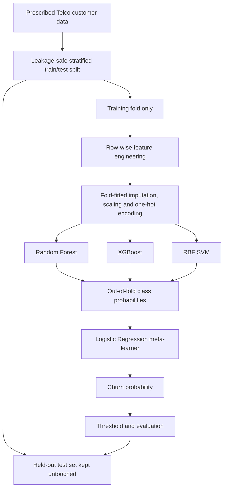
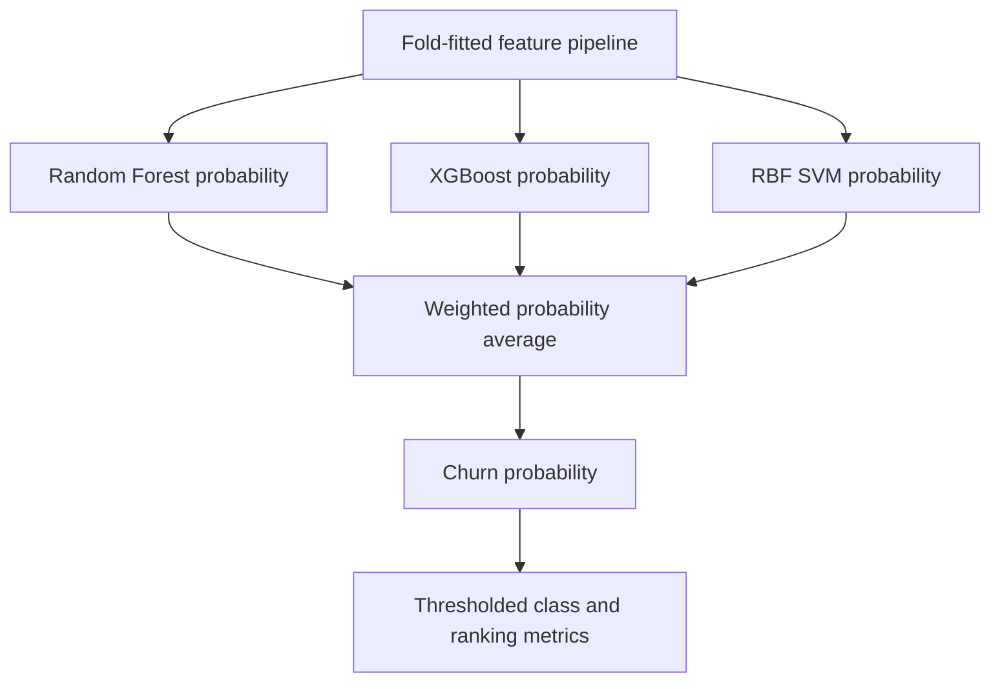
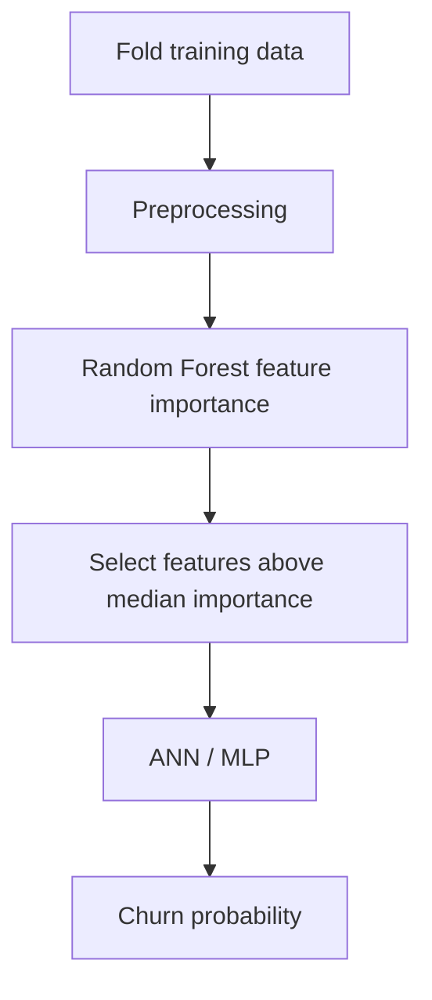
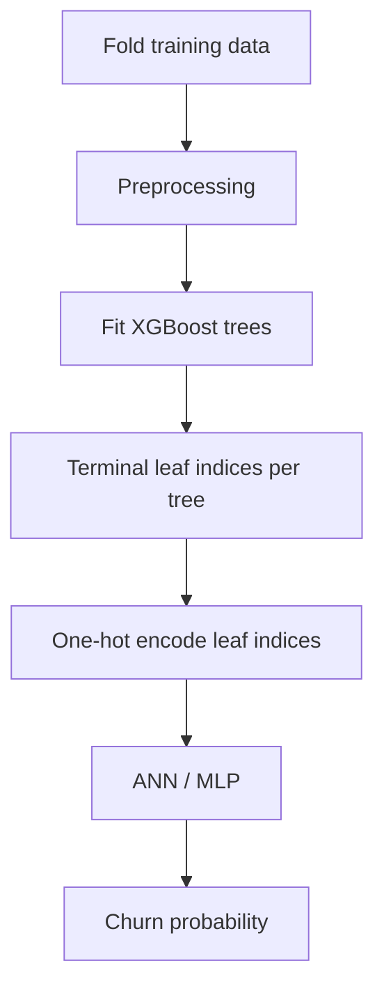
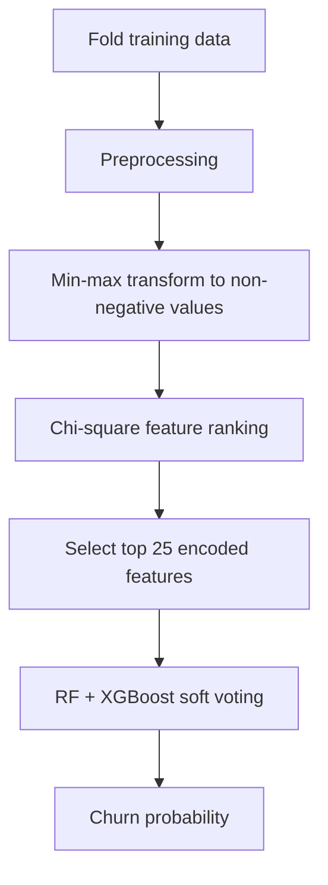

# Hybrid Candidate Architectures

## Candidate A: Stacking ensemble (RF + XGBoost + SVM, Logistic Regression meta-learner)

The stacking meta-learner is trained from out-of-fold predictions, not from base-model predictions on the same rows used to fit those base models. This reduces meta-level leakage.

## Candidate B: Weighted soft voting

The current candidate weights are RF = 0.2, XGBoost = 0.6 and SVM = 0.2. They are a preselected experimental configuration, not yet tuned weights.

## Candidate C: RF feature selection + ANN

## Candidate D: XGBoost leaf representation + ANN

## Candidate E: Chi-square feature selection + ensemble

All candidates use the prescribed CSV, a common fixed hold-out split, and five-fold stratified CV on the training portion. Preprocessing and selection are fitted inside the pipeline on each training fold.
